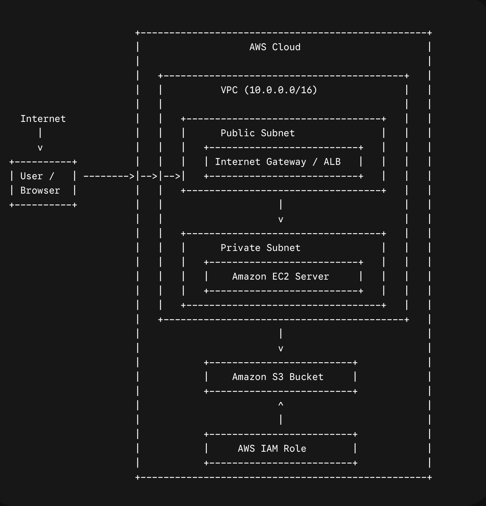

{\rtf1\ansi\ansicpg1252\cocoartf2907
\cocoatextscaling0\cocoaplatform0{\fonttbl\f0\fswiss\fcharset0 Helvetica;}
{\colortbl;\red255\green255\blue255;}
{\*\expandedcolortbl;;}
\paperw11900\paperh16840\margl1440\margr1440\vieww11520\viewh8400\viewkind0
\pard\tx720\tx1440\tx2160\tx2880\tx3600\tx4320\tx5040\tx5760\tx6480\tx7200\tx7920\tx8640\pardirnatural\partightenfactor0

\f0\fs24 \cf0 # AWS Cloud Infrastructure Project\
\
## Overview\
Completed as part of the AWS Cloud Computing Internship curriculum with Internship Studio. This project demonstrates hands-on implementation of cloud deployment, storage, and networking using Amazon Web Services.\
\
## Architecture Diagram\
\
\
## AWS Services Used\
* **Amazon EC2:** Virtual server hosting for application backend.\
* **Amazon S3:** Object storage for static assets and backups.\
* **AWS IAM:** Identity & Access Management for secure role and policy configurations.\
* **Amazon VPC:** Virtual Private Cloud for isolated network environment setup.\
\
## Key Implementation Steps\
1. **Identity & Security Setup:** Configured IAM roles, groups, and restricted access policies.\
2. **Networking:** Created custom VPC, public/private subnets, and security groups.\
3. **Compute & Storage:** Provisioned EC2 instances and attached S3 buckets with appropriate bucket policies.\
\
## Key Takeaways\
* Hands-on practice with AWS core services and cloud security best practices.\
* Real-world experience in setting up scalable and secure cloud infrastructure.\
*}